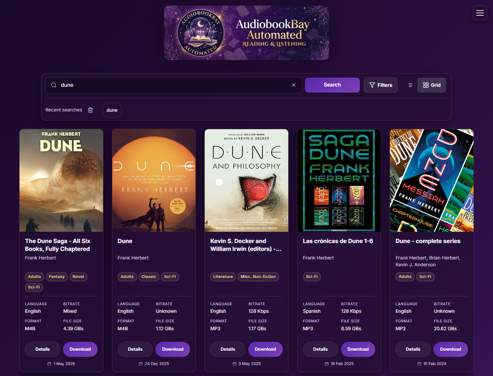
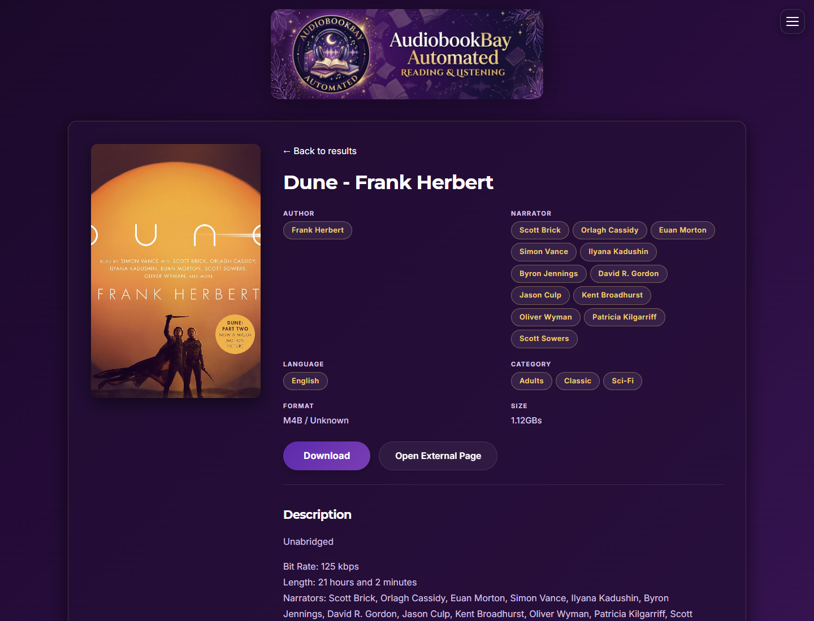
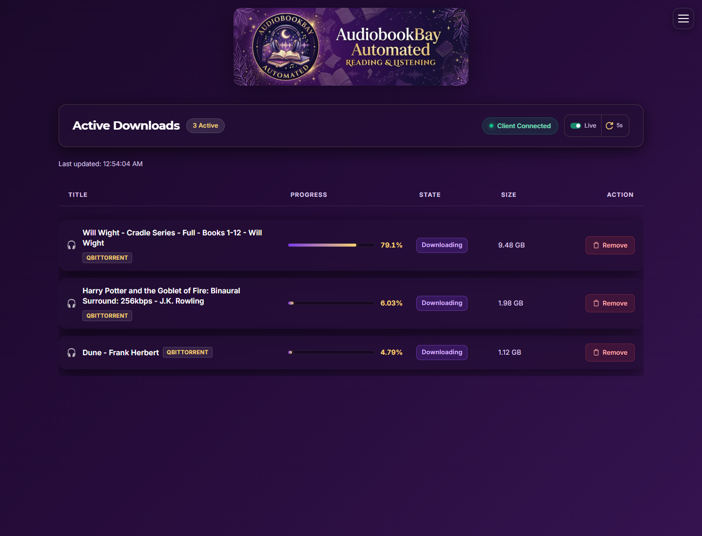

<!-- File: README.md -->
# AudiobookBay Automated

Find audiobooks on AudioBook Bay and send them to **qBittorrent, Transmission, Deluge, or Put.io**. Your Download Client
downloads and stores the files; this app provides search, book details, and download progress.

## Install with Docker

This is the recommended setup. Install [Docker](https://docs.docker.com/get-started/get-docker/) with Compose 2.24 or
newer, and have one supported Download Client running.
For qBittorrent, Transmission, or Deluge, make sure you can open that client's web interface and sign in.

### 1. Create a folder for the app

Save these two files in the same folder:

- [Download the Compose example](https://raw.githubusercontent.com/meek2100/audiobookbay-automated/main/examples/docker-compose.env.yaml)
  and save it as **compose.yaml**.
- [Download the settings example](https://raw.githubusercontent.com/meek2100/audiobookbay-automated/main/examples/.env.example)
  and save it as **.env**.

If you use Windows, turn on **File name extensions** in File Explorer and check that neither filename ends in `.txt`.

### 2. Enter your connection settings

Open `.env` in a text editor. The example is ready for **qBittorrent**; replace its address and login details:

| Setting | What to enter |
| --- | --- |
| `DL_CLIENT` | `qbittorrent` for this example |
| `QBITTORRENT_HOST` | The address of the server running your Download Client, such as `192.168.1.100` |
| `QBITTORRENT_PORT` | Its web-interface port; normally `8080` (leave unset for the default) |
| `QBITTORRENT_USERNAME` | The username you use to sign in to that web interface |
| `QBITTORRENT_PASSWORD` | Its password; keep the surrounding single quotes |

If the client is reachable at `127.0.0.1` from inside the app, omit HOST and PORT to use the local defaults.
Separate Docker containers normally need the client's service name; another server needs its reachable address.

Downloads use the folder already configured in your Download Client. No download-folder setup or volume mount is
needed in this app. To choose a different destination, see [optional download folders](docs/configuration.md#download-folders).

For Transmission, Deluge, Put.io, several clients, or Windows paths, use the
[client setup examples](docs/configuration.md#download-clients). Settings are named for each client; for example,
Transmission uses `TRANSMISSION_PASSWORD`. Capitalization does not matter for app setting names; the examples
use uppercase consistently.
Deluge users should enable the **Label** plugin so downloads can be organized by category.

### 3. Start the app

Open Terminal or PowerShell **in the folder containing compose.yaml**, then run:

~~~shell
docker compose up -d
~~~

Open **<http://localhost:5078>** if Docker runs on this computer. If it runs on a home server, replace `localhost` with
that server's address, for example **<http://192.168.1.100:5078>**.

The prebuilt image is `ghcr.io/meek2100/audiobookbay-automated:latest`. It becomes available when a release is published.
Before the first release, use the [source-build instructions](docs/development.md#run-the-container-from-source).

### 4. Check the connection

Open **Status** in the menu to view your downloads.
If the app reports that your Download Client is disconnected, check its address, port,
username, and password in `.env`. Then apply the settings:

~~~shell
docker compose up -d --force-recreate
~~~

Keep the app on your private network. For access over the internet, use an authenticated reverse proxy; the app has
no sign-in screen of its own. Set `PUBLIC_URL` to the full address you open in your browser, such as
`https://myaudiobooks.com`. Local HTTP needs no extra settings. See the
[reverse-proxy setup](docs/configuration.md#reverse-proxy-and-https) for the short Nginx Proxy Manager example.

## Find and download a book

1. Enter a title, author, or keyword and select **Search**. Searches need at least two characters.
2. Open **Details** to read about a book, or choose **Download** to send it to your Download Client.
   With several clients configured, choose a connected client in the download dialog. Offline clients cannot be selected.
   With one client, Download sends directly without this dialog.
3. Open **Status** in the menu to follow download progress.
   Your Download Client controls where files are stored and when they finish.

Near the bottom, more results load automatically. **Load more audiobooks** also lets you request the next page manually.
While a request is running, one spinner and **Loading audiobooks…** message replace the button. If it fails, select
**Retry loading audiobooks**. An end message confirms when there are no more results, and the button disappears.

The **×** at the end of the search box clears its text and returns focus so you can type another search. It does not
submit a request or discard the results already on screen. To clear filters, open **Filters → Reset filters**.

**Filters apply only to results already loaded.** The Author / contributor filter uses recognizable credits in titles,
so some listings may have no credit. Narrator details appear on the Details page when the catalog supplies them.

Click a category, language, author, or narrator link to browse related books. You can also enter these searches directly:

| Browse by | Example |
| --- | --- |
| Category | `category:Fantasy` |
| Language | `language:German` |
| Author | `author:J.R.R. Tolkien` |
| Narrator | `narrator:Gert Heidenreich` |

Author and narrator searches use the catalog’s keyword search and may include related titles. Dotted author initials
are omitted so different catalog spellings still match. They do not fetch each book’s Details page.

Recent searches appear inside the search panel and are kept in your browser tab. The trash icon beside
**Recent searches** clears that history. The menu also lets you choose a color theme.

## Update or stop the app

Run these commands in your app folder to install the latest published image. Your `.env` settings and Download Client
files stay in place:

~~~shell
docker compose pull
docker compose up -d
~~~

To stop the app:

~~~shell
docker compose down
~~~

## Troubleshooting

| What you see | What to check |
| --- | --- |
| The image cannot be downloaded | Check your internet connection and the image name. A first release must be published before `latest` exists. |
| The app will not start | Check `.env` for a valid `DL_CLIENT` and its connection settings. Run `docker compose logs --tail=50` to see the reason. |
| Setup warning about a missing login | Add the setting named in the log to `.env`, then recreate the app with `docker compose up -d`. The website can still open while a client is offline. |
| The browser cannot open the app | Check that Docker is running, port `5078` is available, and you used the correct server address. |
| Download says the page expired | Refresh the page and try again. If you changed the site address or restarted the app, open a fresh page first. LAN HTTP and the configured public HTTPS address use separate sessions. |
| Download Client disconnected | Read the connection help in the banner, Download Client picker or Status page. Check its address, port and login. HOST and PORT are optional for a client sharing the app's network. For a separate container/server, use its service name or reachable address. |
| Search is unavailable | Wait a moment and retry. If it continues, check your internet/VPN connection. Enable [Diagnostics](docs/configuration.md#diagnostics-and-network) to see mirror availability. |
| A book does not appear in Downloads | Check the Download Client itself and its `abb-automated` category/label. Some clients take time to retrieve torrent information. |
| Files are saved in the wrong folder | Check the client's default folder or any optional save-path override in `.env`. |

Optional guides: [appearance, Download Clients and networking](docs/configuration.md),
[Audiobookshelf scans](docs/configuration.md#audiobookshelf), and [development/testing](docs/development.md).

## Screenshots

These show the default purple theme with real catalog results and Download Client status.

## Help and contributions

[Report a problem](https://github.com/meek2100/audiobookbay-automated/issues) with what you tried and what happened.
Remove passwords, tokens, and private addresses from any logs you share.

Developers: start with [the development guide](docs/development.md) and [AGENTS.md](AGENTS.md).
